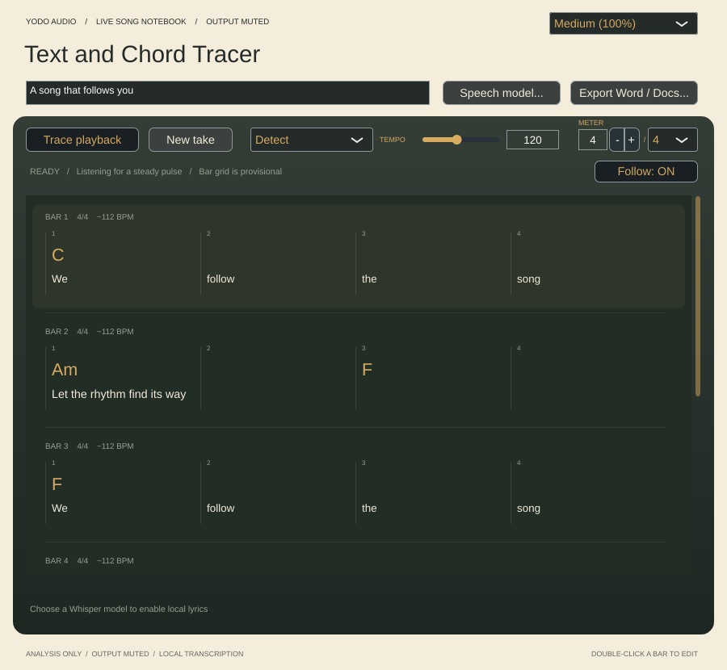

# Text and Chord Tracer

An analysis-only Apple Silicon VST3 song notebook: local lyric transcription, provisional audio
chord recognition and a scrolling lead sheet with lyrics under chord positions.
It uses the cream, charcoal and brass studio UI, three interface sizes, session
recall and Mac build/sign/install workflow of the other Doornenbal Audio plugins.



## Timing that follows a performance

The timing selector has three automatable modes:

- **Detect** (default): estimate a moving tempo from the music's onset envelope,
  gently follow nearby beat onsets, and propose 3/4 or 4/4 when accent patterns
  provide enough evidence. Otherwise the meter controls provide a provisional
  grouping. Initial silence is skipped. This mode does not use the DAW tempo.
- **Hint + follow**: enter an approximate **quarter-note BPM**, beats per bar and
  beat unit. The meter is your indication; tempo estimation and beat following
  continue as the performance changes. Updating the BPM hint supplies a new
  starting indication rather than permanently locking the performance to it.
  Meter hints support 2–12 beats and beat units 4, 8 and 16, including 6/8.
- **DAW**: use the host's tempo, time signature, PPQ and bar information. A host
  without valid musical position falls back to the provisional audio grid.

Each captured bar keeps its local tempo estimate. Free timing, rubato, pickups,
compound meter, weak drums and half/double-tempo ambiguity can prevent a reliable
bar interpretation. The grid is deliberately labelled provisional. The audio
meter detector currently distinguishes accented 3/4 and 4/4; it does not claim
to infer every time signature. Use Hint + follow for 6/8 or another grouping.
There is no time stretching or quantisation of the audible performance.

For REAPER, a dedicated analysis track with separate instrument and vocal sends
is recommended. See [REAPER routing](docs/REAPER.md).

## Capturing lyrics and chords

1. Insert **Text and Chord Tracer** on the stereo full mix or an analysis bus and
   choose a timing mode. Its input is captured for analysis, then all output is silenced.
2. For better words, enable the plugin's optional **Clean vocal** stereo input in
   the host and route an isolated vocal to it. Music still comes from the main
   input for chord analysis. Without that bus, words are attempted from the mix.
3. Enable **Trace playback**, then play the song. The sheet grows as music is
   analysed. **Follow: ON** slowly scrolls when the display fills; turn it off to
   read earlier bars. Double-click a bar to correct its chord row and lyrics.
   Separate chord beat positions with `|` (for example `C | | F | G`).
4. Stop playback or turn Trace playback off and wait for pending transcription
   to finish. Export becomes available when capture and pending work finish.
   If the host stops issuing callbacks, a timer requests a final flush.
5. **New take** clears the notebook. Use it to transcribe a new pass. Existing
   lyric bars and manual corrections are protected from duplicate text on
   replay; chord guesses can update unless manually edited.

Words arrive in chunks, usually after about eight seconds plus recognition time;
this is not zero-latency karaoke. Two-second context overlap helps chunk edges.
Words are approximately distributed within Whisper's timestamped phrases, then
placed using the captured moving grid. Word-to-chord placement is therefore an
editable draft, not precise forced alignment. The final short tail is flushed at
stop. Very short isolated fragments may not supply enough speech context.

Chord recognition uses stereo spectral power (so opposite-polarity channels do
not cancel), pitch-class templates and short stability filtering. It proposes
major, minor, dominant seventh, major/minor seventh, suspended, diminished and
augmented shapes. It does not reliably identify every inversion, slash chord,
extension or ambiguous voicing, especially in dense mixes. Review the guesses.

Both background queues are bounded. A backlog indicator appears if processing
cannot keep up and audio is skipped. Captured notes are capped at 2,048 bars per
take. Nothing is allocated, locked or transcribed in the audio callback; inputs are copied for analysis before the output buffer is cleared. Sidechain input buffers remain untouched. The
plugin is intentionally silent, including its bypass callbacks. A DAW can route
around a hard-bypassed or removed plugin, so keep Master/parent send disabled as
a second safeguard. Session recall preserves the title, settings, model path,
lead sheet and manual corrections; raw audio and model weights are not embedded.

## Local transcription setup

Lyrics use pinned **whisper.cpp v1.7.6**. No audio is uploaded and no account or API
key is required. A multilingual model file is required; instrumental audio is not
a substitute for a clean vocal. Whisper is a speech recogniser, so sustained
singing, backing vocals, loud accompaniment and repeated phrases may yield missing
or incorrect words. There is no built-in source separation or singer separation.
The engine auto-detects language and keeps the original language.

The Mac installation script downloads the multilingual **base** model (~142 MiB)
and verifies its upstream checksum. **Speech model...** lets you select a model
file. A larger `small` model may improve results at greater CPU and memory cost:

```sh
bash scripts/download-model.sh small
```

Select that file with **Speech model...** afterwards. `tiny` is also supported.
Models live in:
`~/Library/Application Support/Doornenbal Audio/TextAndChordTracer/models/`.
A missing model is shown explicitly; chord analysis and manual editing still work.

## Word and Google Docs export

**Export Word / Docs...** creates a native `.docx` file containing the song title,
measure numbers, local tempo/meter indications, chord cells, and lyrics underneath.
Manual lyric corrections span the bar. XML text is escaped and the file is written
through a temporary file before replacement. Open it directly in Microsoft Word.
For Google Docs, upload the same `.docx` to Google Drive and choose **Open with >
Google Docs**. The plugin does not sign into Google or upload documents itself.

## Build, sign and install on a Mac M2

Native Apple Silicon arm64 VST3, macOS 11+. Install Xcode Command Line Tools and
CMake 3.22+, close the DAW, then:

```sh
git clone https://github.com/johandoornenbal/textAndChordTracer.git
cd textAndChordTracer
bash scripts/build-sign-install-mac.sh
```

This fetches pinned JUCE and whisper.cpp sources, builds and tests the plugin,
downloads the base speech model, ad-hoc signs a staged bundle, verifies it, then
installs to `~/Library/Audio/Plug-Ins/VST3/Text and Chord Tracer.vst3`.
An existing installation is preserved until the staged copy passes verification;
replacement failure attempts to restore it. No sudo is used. Restart/rescan the
DAW afterwards. It is not notarized; there is no AU target for Logic Pro.

To install an extracted GitHub Actions bundle:

```sh
bash scripts/build-sign-install-mac.sh --install-only "/path/to/Text and Chord Tracer.vst3"
```

`TRACER_BUILD_DIR` / `TRACER_INSTALL_DIR` override folders.
`TRACER_SKIP_MODEL_DOWNLOAD=1` keeps model setup manual; `TRACER_MODEL=small`
selects a larger download. Extra CMake options pass through to configuration,
including `-DJUCE_PATH=/path/to/JUCE` and `-DWHISPER_PATH=/path/to/whisper.cpp`.
Speech resources run on background threads, with up to four inference CPU threads;
Metal kernels are embedded for Apple Silicon builds.

## Development checks

Musical analysis tests without JUCE or speech dependencies:

```sh
cmake -S . -B build-core -DTRACER_CORE_ONLY=ON -DCMAKE_BUILD_TYPE=Release
cmake --build build-core --parallel 3
ctest --test-dir build-core --output-on-failure
```

Full development build:

```sh
cmake -S . -B build -DCMAKE_BUILD_TYPE=Release
cmake --build build --parallel 3
ctest --test-dir build --output-on-failure
```

Linux needs JUCE's normal ALSA, font and X11 development dependencies. The rootless
`scripts/setup-cloud.sh` and `scripts/cloud-env.sh` helpers follow the earlier projects. A developer
can use `-DTRACER_WITH_WHISPER=OFF` for chord/UI-only builds; release builds keep it on.
Tests cover synthetic chord fixtures, stereo polarity, pulse tempo, measure
placement, actual background capture with tempo changes, stale-take rejection,
float/double silent output, capture before muting, bypass callbacks, lead-sheet edits/recall, UI sizes and valid Word
XML. The editor test writes `build/ui-preview.png` with demonstration text and
`build/lead-sheet.docx`. Demo words in the preview are not a recognition result.

Actual model inference is a separate test. It is explicitly **skipped** if
`TRACER_TEST_MODEL` is unset, rather than reported as passing. The Mac workflow
downloads a pinned tiny model and runs it on whisper.cpp's bundled JFK **speech**
fixture. This checks integration, not sung-lyric accuracy. Native DAW playback,
real singing and expressive tempo/meter detection still require musical review.
The current cloud environment blocks the model host, so local model inference
cannot be validated here; the backend is compiled into the VST3.

## Licenses

The wrapper, musical analysis and UI are MIT. whisper.cpp and its ggml dependency
retain their MIT notices. JUCE has separate AGPLv3/commercial licensing; distributing
the plugin requires the appropriate JUCE terms. See [THIRD_PARTY.md](THIRD_PARTY.md).
